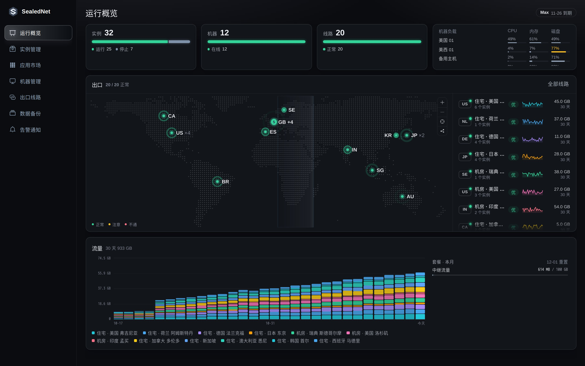
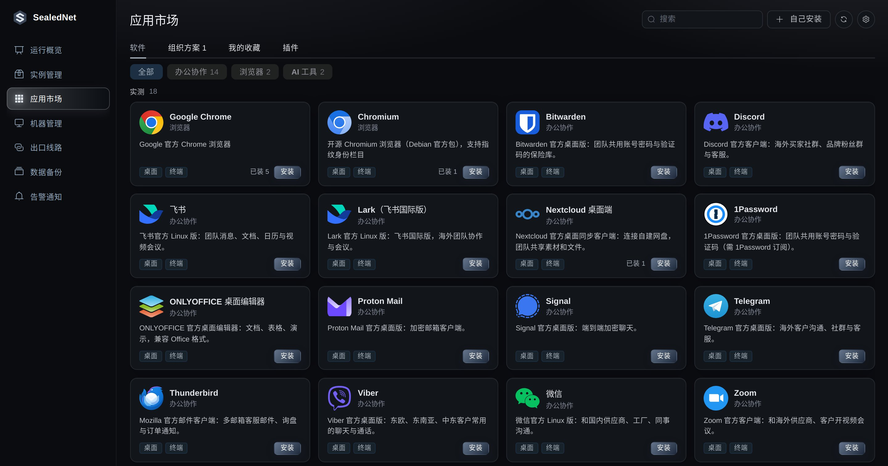
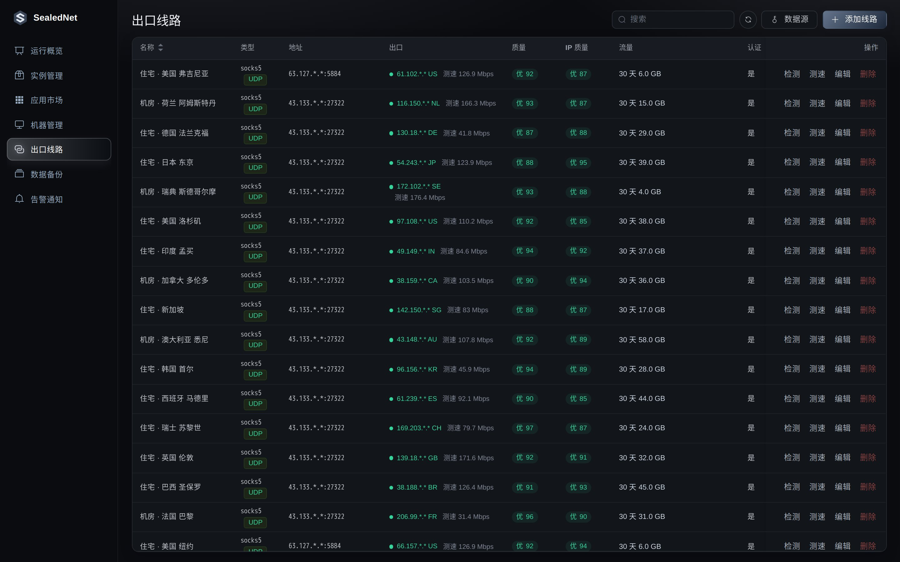
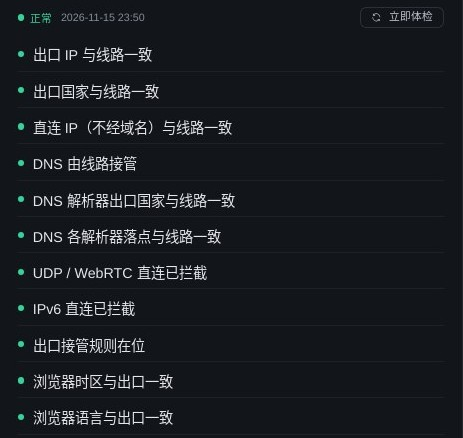

  <a href="https://sealednet.com/en/">
    <picture>
      <source media="(prefers-color-scheme: dark)" srcset=".github/assets/lockup-dark.svg">
      
    </picture>
  </a>

<b>A separate environment for every team and every client.</b> Timezone and language follow the line's exit. If the line drops, the environment goes offline instead of falling back to the machine's own network.

  <a href="https://sealednet.com/en/">Website</a> ·
  <a href="https://sealednet.com/en/docs/quickstart">Quick start</a> ·
  <a href="https://sealednet.com/en/docs/capabilities">What it does</a> ·
  <a href="https://sealednet.com/en/pricing">Pricing</a> ·
  <a href="README.md">中文</a>

Screenshots show the Chinese interface with demo data; the console is also available in English.

## Who it's for

- **Cross-border e-commerce teams**: one environment per store or marketplace, each always exiting from the matching country, with browser timezone and language to match.
- **Agencies and overseas operations**: one environment per client, with separate data and sessions; hand environments to team members instead of passing passwords around.
- **Distributed teams**: open the same cloud environment from any browser, switch computers, or pick up on a phone.

## Why not build it yourself

| Common setup | What goes wrong | With SealedNet |
| --- | --- | --- |
| Everyone shares one computer and one browser | Data from different businesses and clients gets mixed; timezone, language and exit don't match | Every environment has its own data volume and network; timezone and language follow the line |
| A cloud server plus remote desktop per person | Each one set up by hand; nobody notices when a line breaks | Install environments from the console, scheduled exit checks and alerts |
| System proxy or a browser proxy extension | When the line drops, traffic quietly moves to the local network | Environments can only use their bound line; no line, no network (UDP included) |

## Features

### Environments: browser, desktop, terminal, apps

Ready-made templates such as cloud browser, Linux desktop, terminal and an Android development environment; an app catalog of common collaboration tools that installs from official sources only; or your own Docker image. Every environment has its own data volume, and updates only swap the image.

### Access: all you need is a browser

- **Desktop** in the browser, direct WebRTC first with a relay as fallback; mobile browsers work too.
- **Terminal** in the browser.
- **Web ports**: the application's own web UI, opened after signing in to SealedNet, optionally public.
- **Other ports**: database, SSH and similar ports mapped to a machine port (TCP).

No remote-access software to install.

### Lines: bring your own, see their quality at a glance

SOCKS5 and HTTP proxies. Checks run from your machine through the line itself: exit IP, country, city, ISP, type, quality grade and speed, with 90 days of history. Changes in exit IP or country and drops in grade are flagged and can trigger alerts.

### Exit checks for every environment

Exit IP, DNS, UDP and WebRTC, IPv6, timezone, language and more, checked one by one and re-checked on a schedule. Lock an exit to a country and know right away when a line's exit moves.

### Teams and operations

- Owner, admin, member and read-only roles; assign environments per person.
- Machine load, traffic, backups and alerts in one console.

## Where it runs

| | Requirements |
| --- | --- |
| Windows PC | Windows 10 22H2 or Windows 11, x64, virtualization enabled, at least 4 GB of RAM (8 GB recommended). One command in PowerShell; starts with the PC |
| Linux server | x86_64 or arm64, root access; Docker is installed if missing. Cloud servers and office machines both work |
| Network | Outbound access to the console only; no public IP and no open ports |

SealedNet hosts the console, ready as soon as you sign up. Environments run on your own machine and their traffic goes straight from your machine into your line; **it never passes through SealedNet**.

## What it is not

- **Not a proxy seller**: lines are SOCKS5 or HTTP proxies you obtain lawfully yourself.
- **Not a VPN or accelerator**: it manages environments on your machine and leaves your computer's own network alone.
- **Not a hosting provider**: environments run on your Windows PC or your own Linux machine.

## Getting started

1. Sign up at [sealednet.com](https://sealednet.com/en/) and verify your email.
2. Add a machine in the console and run the install command on your Windows PC or Linux server.
3. Add a line and run a check.
4. Install an environment from the catalog and open it in the browser.

The full walkthrough is in the [quick start](https://sealednet.com/en/docs/quickstart); all docs are at [sealednet.com/en/docs](https://sealednet.com/en/docs/).

## About this repository

This is SealedNet's official home on GitHub; it does not contain the product's source code. Screenshots use demo data. Questions and suggestions are welcome as [issues](https://github.com/sealednet/sealednet/issues), or reach us via [support](https://sealednet.com/en/docs/support).
