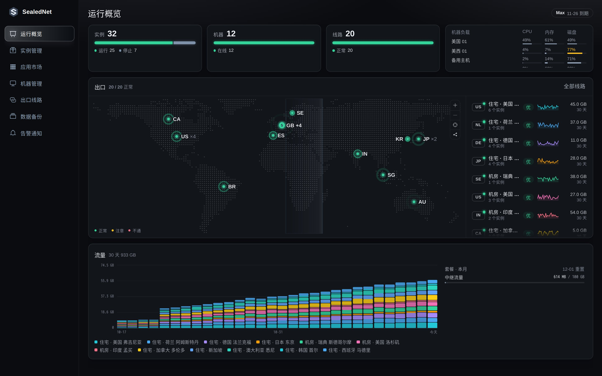
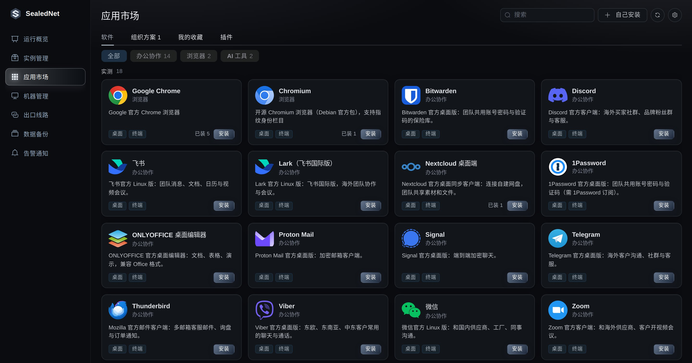
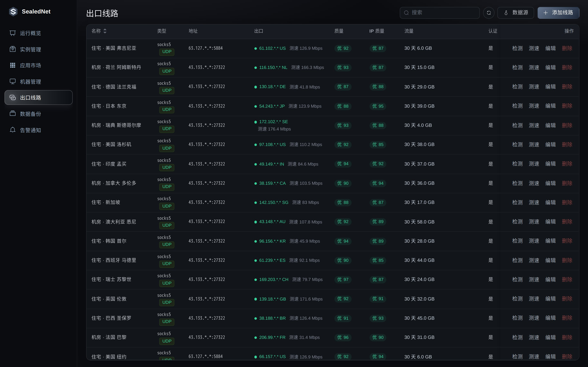
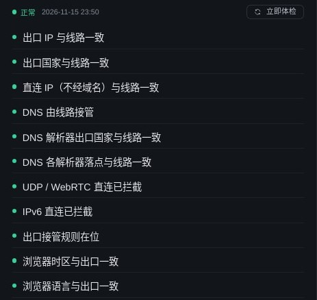

  <a href="https://sealednet.com">
    <picture>
      <source media="(prefers-color-scheme: dark)" srcset=".github/assets/lockup-dark.svg">
      
    </picture>
  </a>

<b>每个团队、每个客户，一个独立的上网环境。</b> 时区和语言跟着线路出口走，线路断了就断网，不会回落到机器自己的网络。

  <a href="https://sealednet.com">官网</a> ·
  <a href="https://sealednet.com/docs/quickstart">快速开始</a> ·
  <a href="https://sealednet.com/docs/capabilities">产品能力</a> ·
  <a href="https://sealednet.com/site/pricing">定价</a> ·
  <a href="README.en.md">English</a>

## 适合谁

- **跨境电商团队**：按店铺、站点分环境，每个后台固定从对应国家的线路出去，浏览器的时区、语言和出口一致。
- **海外运营 / 代运营**：每个客户一个独立环境，数据、登录状态互不影响；交接时按环境分配给成员，不用来回传密码。
- **分布式团队**：成员在浏览器里直接打开同一个云端环境，换电脑、出差用手机也能接着干。

## 为什么不是自己搭

| 常见做法 | 实际遇到的问题 | 用 SealedNet |
| --- | --- | --- |
| 大家共用一台电脑、一个浏览器 | 不同业务和客户的数据混在一起，时区、语言和出口对不上 | 每个环境独立的数据卷和网络，时区、语言自动跟随线路 |
| 每人一台云服务器 + 远程桌面 | 一台台装系统、配代理；线路出问题没人发现 | 面板里一键装环境，出口定时体检，异常告警 |
| 系统代理或浏览器代理插件 | 线路一断，流量悄悄改走本机网络 | 环境只能走绑定的线路，线路不通就没有网络（包括 UDP） |

## 主要功能

### 环境：浏览器、桌面、终端、应用

云浏览器、Linux 桌面、终端、安卓开发环境等模板开箱即用；应用市场里有常用的办公协作软件，只登记官方安装源；也可以填你自己的 Docker 镜像。每个环境有独立的数据卷，更新只换镜像、数据不动。

### 打开方式：只要一个浏览器

- **桌面**：网页里直接操作，优先 WebRTC 点对点直连，不通时自动走中继；手机浏览器也能用。
- **终端**：网页里进环境的命令行。
- **网页端口**：应用自带的网页，经 SealedNet 登录后打开，也可以设为公开访问。
- **其他端口**：数据库、SSH 这类端口映射到机器端口（TCP）。

不用装任何远程软件。

### 线路：接你自己的，质量一眼看清

支持 SOCKS5 和 HTTP 代理。每条线路由你的机器经这条线路发起检测：出口 IP、国家、城市、运营商、类型、质量等级和测速，历史保留 90 天；出口 IP、国家变了或等级下降都会标出来，可以接告警。

### 出口体检：每个环境逐项核对

出口 IP、DNS、UDP 与 WebRTC、IPv6、时区、语言等逐项检查，定时自动复检。出口可以锁定到国家，线路换了出口也能第一时间发现。

### 团队与运维

- 所有者、管理员、成员、只读成员四种角色，环境可以按人分配。
- 机器负载、流量统计、数据备份、告警通知都在面板里。

## 运行在哪

| | 要求 |
| --- | --- |
| Windows 电脑 | Windows 10 22H2 或 Windows 11，x64，开启虚拟化，内存至少 4G（建议 8G）。PowerShell 里一行命令安装，开机自动运行 |
| Linux 服务器 | x86_64 或 arm64，root 权限；没有 Docker 时自动安装。云服务器、办公室的主机都可以 |
| 网络 | 只需要能访问面板（出站连接），不需要公网 IP，不用开端口 |

面板由 SealedNet 托管，注册即用；环境跑在你自己的机器上，上网流量从你的机器直接进你的线路，**不经过 SealedNet**。

## 不是什么

- **不卖线路**：线路是你自己依法取得的 SOCKS5 或 HTTP 代理。
- **不是 VPN 或加速器**：只管理你机器上的环境，不改电脑本身的网络。
- **不提供服务器**：环境跑在你的 Windows 电脑或你自己的 Linux 机器上。

## 上手

1. 在 [sealednet.com](https://sealednet.com) 注册并验证邮箱。
2. 在面板里添加机器，把安装命令复制到你的 Windows 电脑或 Linux 服务器上运行。
3. 添加线路，点一下检测。
4. 从应用市场装一个环境，在浏览器里打开。

完整步骤见 [快速开始](https://sealednet.com/docs/quickstart)，所有文档见 [文档中心](https://sealednet.com/docs/)。

## 关于这个仓库

这是 SealedNet 在 GitHub 上的官方主页，不包含产品源码。截图为演示数据。问题和建议欢迎提 [Issue](https://github.com/sealednet/sealednet/issues)，也可以通过 [联系我们](https://sealednet.com/docs/support) 找到客服。
